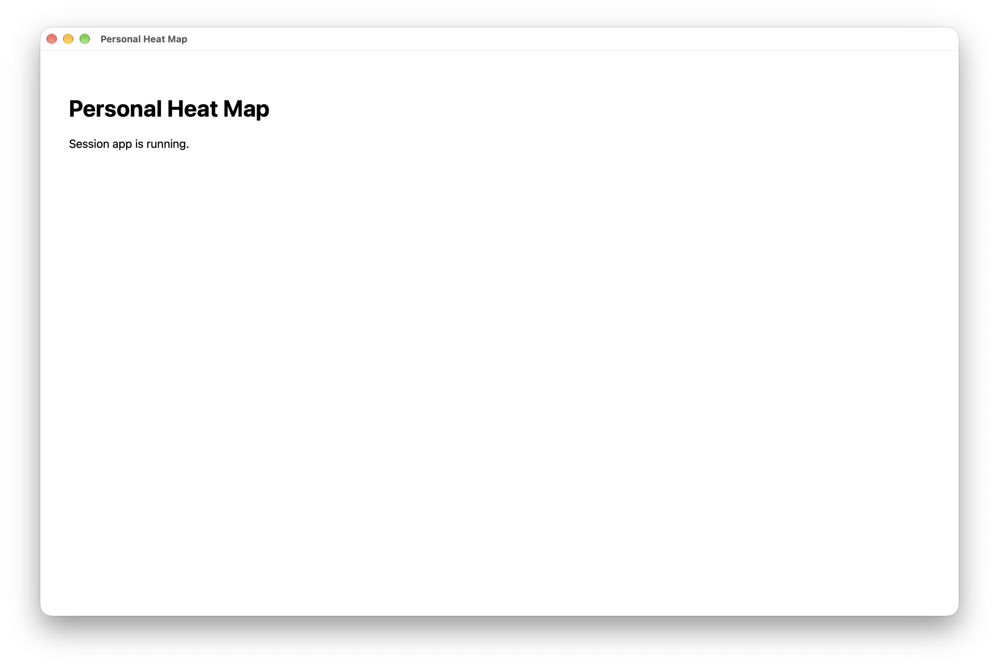

# Task 01 Proofs - Native app shell with a locked-down local server

## Task Summary

Task 1.0 sets up the project (uv, Python 3.15, Django 6.1) and the desktop shell. `uv run heatmap` starts a local server, opens the app in a native pywebview window, and shuts the server down when the window closes. The server listens on `127.0.0.1` only and rejects any request that lacks the secret generated at each launch.

## What This Task Proves

- The app opens as a native macOS window with no address bar or tabs. This was the biggest technical unknown: pywebview on Python 3.15.
- The local server binds only to `127.0.0.1`, on a free port chosen at launch.
- Closing the window stops the server. No process or listening socket is left behind.
- Requests without the launch secret, including requests to the admin, are rejected with 403.
- Tests and lint pass.

## Evidence Summary

- A screenshot shows the app in its own window.
- `lsof` showed the app listening on `127.0.0.1` while it was running, and showed nothing after the window closed. The process exited with code 0.
- All 11 tests in `test_access.py` and `test_server.py` pass.
- `ruff check` and `ruff format --check` are clean.

## Artifact: App running in its own window

**What it proves:** the UI runs in a native window, not a browser tab.

**Why it matters:** the spec's main design goal is that the app feels like an application, not a webpage.

**Artifact path:** `docs/specs/01-spec-session-mvp/01-proofs/01-task-01-app-window.png`

**Result summary:** the window titled "Personal Heat Map" shows the placeholder home screen, with only standard macOS window controls and no browser chrome.

## Artifact: Bound to loopback while running, nothing left after close

**What it proves:** the server is reachable only from this machine, and it stops when the window closes.

**Why it matters:** session data is highly sensitive. It must not be reachable from the network, and closing the app must really close it.

**Commands:**

~~~bash
uv run heatmap                                   # launched, window shown
lsof -iTCP -sTCP:LISTEN -P -n | grep -i python   # while running
# ...window closed by hand...
pgrep -fl "bin/heatmap"; lsof -iTCP -sTCP:LISTEN -P -n | grep -i python
~~~

**Result summary:** while the app was running, the only listener was `127.0.0.1` on a random port. After the window closed, the process exited with code 0 and no Python listeners remained.

~~~text
# while running
Python    20758 jacob    7u  IPv4 ...  0t0  TCP 127.0.0.1:63071 (LISTEN)

# after closing the window
[exited with code 0]
--- pgrep:
no heatmap process
--- lsof python listeners:
(none)
~~~

## Artifact: Access-check and server tests

**What it proves:**
- Requests need the launch secret.
- `/launch/` checks the token and sets an HttpOnly, SameSite=Strict cookie.
- An empty server token rejects everything.
- The server binds only to `127.0.0.1`, starts, and stops cleanly. This part is tested without a window.

**Why it matters:** this is the automated guard on the local access check and on shutdown.

**Command:** `uv run pytest -v tests/test_access.py tests/test_server.py`

**Result summary:** 11 passed.

~~~text
tests/test_access.py::test_request_without_launch_secret_is_rejected PASSED
tests/test_access.py::test_request_with_wrong_secret_is_rejected PASSED
tests/test_access.py::test_request_with_launch_secret_is_accepted PASSED
tests/test_access.py::test_launch_with_wrong_token_is_rejected PASSED
tests/test_access.py::test_launch_sets_cookie_and_unlocks_app PASSED
tests/test_access.py::test_empty_server_token_rejects_everything PASSED
tests/test_access.py::test_admin_also_requires_launch_secret[/admin/] PASSED
tests/test_access.py::test_admin_also_requires_launch_secret[/admin/login/] PASSED
tests/test_server.py::test_find_free_port_returns_unused_port PASSED
tests/test_server.py::test_server_binds_to_loopback_only PASSED
tests/test_server.py::test_server_starts_and_stops PASSED
============================== 11 passed in 0.27s ==============================
~~~

## Artifact: Lint and format

**What it proves:** the code meets the repository's ruff configuration.

**Command:** `uv run ruff check . && uv run ruff format --check .`

**Result summary:** clean.

~~~text
All checks passed!
19 files already formatted
~~~

## Reviewer Conclusion

The app shell works end to end on Python 3.15: a native window, a server reachable only from this machine and gated by the launch secret, and a clean shutdown when the window closes. The access and server behavior is covered by automated tests. The window and shutdown were checked by hand.
