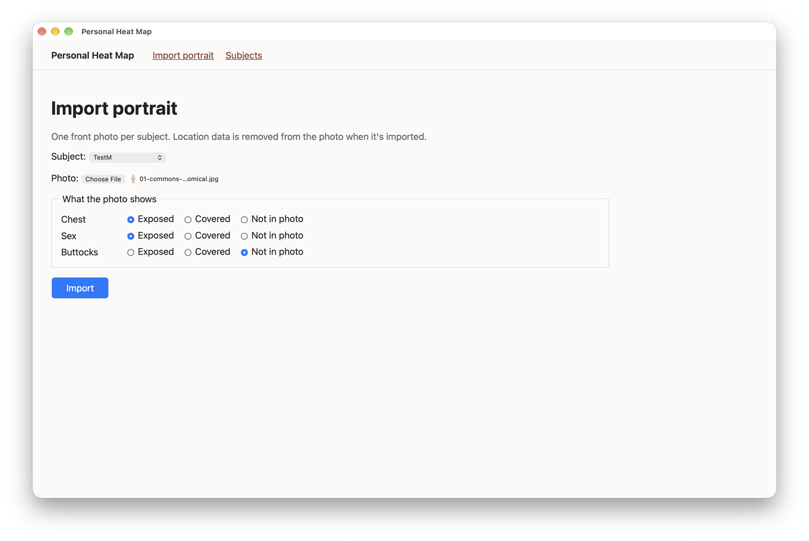

# Task 02 Proofs - Portrait import with location removal, coverage and subject intake

## Task Summary

The app now has its first working screen. From inside the app window, you pick a subject, choose a photo with the macOS file picker, and record what the photo shows. The import:

- Straightens the photo.
- Removes location data (the GPS block and XMP), keeping camera details.
- Saves it under an ID-only path in the git-ignored `recordings/` folder.

Coverage is recorded for the chest, sex and buttocks, and the overall level is worked out from it. Subjects also gained optional intake fields:

- **Gender**, asked as "Which best describes your gender?": Woman / Man / Non-binary / In my own words / Prefer not to say, with no "Other".
- **Pronouns.**
- **Year of birth** (adults only).

## What This Task Proves

- The macOS file picker opens from the app window (pywebview), so photos can be imported in-app (sub-task 2.1).
- JPEG, PNG and HEIC photos import. HEIC is stored as JPEG.
- The stored copy has no GPS and no XMP location, keeps the camera model, and is rotated upright.
- Files are stored at `recordings/subject_<id>/portrait_<id>/original.<ext>`, with no names in the path. Uploads don't linger in the temp folder.
- Coverage is required, the overall level follows the agreed rules, and a subject can have only one front portrait.
- Subject intake has no "Other" option. "In my own words" requires a description, and year of birth must make the subject 18 or older.

## Evidence Summary

- A screenshot of the import screen in the app window, with the Demo Image chosen through the file picker.
- A manual import of Demo Image 01, checked on disk: no GPS, no XMP, level "nude".
- 31 task-specific tests pass. The full suite (42 tests), `ruff` and the migrations check are clean.

## Artifact: Import screen in the app window

**What it proves:** the in-app import flow works end to end. The file picker opened, and the Demo Image file was chosen and imported with its coverage set.

**Why it matters:** this is the screen used with real subjects. It confirms pywebview's file picker works, which was the early check in sub-task 2.1.

**Artifact path:** `docs/specs/02-spec-portrait-mapping/02-proofs/02-task-02-import.png`

**Result summary:**
- Subject "TestM" is chosen, with `01-commons-male-anatomical.jpg` selected through the picker.
- Coverage is Chest exposed, Sex exposed, Buttocks not in photo.
- After Import, the app showed "Imported a portrait for TestM."

## Artifact: The imported Demo Image on disk

**What it proves:** a real import through the app stores a clean copy at an ID-only path and records coverage correctly.

**Command:** a Django shell script that opens the stored file for subject "TestM" with Pillow.

**Result summary:** the file is stored at `subject_2/portrait_2/original.jpg` with no GPS and no XMP, and the level is "nude", as the rules say for chest and sex exposed with buttocks not in the photo.

~~~text
stored at: subject_2/portrait_2/original.jpg JPEG (1067, 1600)
GPS: False | XMP: False
coverage: exposed exposed not_in_photo -> nude
~~~

## Artifact: Import, coverage and intake tests

**What it proves:**
- **Import (`test_import.py`):**
  - A generated JPEG carrying GPS, XMP location, a camera model and a "rotate 90°" flag is stored without GPS or XMP, with the camera model kept and the pixels upright.
  - HEIC is stored as JPEG and PNG as PNG.
  - A non-photo is refused and leaves nothing behind.
  - The temp upload folder is empty afterwards.
- **Coverage (`test_coverage.py`):** every overall-level rule; coverage required; the labels Chest / Sex / Buttocks; a second front portrait refused by both the form and the database.
- **Subjects (`test_subjects.py`):** no `User` relation; ID-only file name; the intake rules; the admin saves the intake fields.

**Command:** `uv run pytest -v tests/test_import.py tests/test_coverage.py tests/test_subjects.py`

**Result summary:** 31 passed.

~~~text
tests/test_import.py::test_import_stores_cleaned_jpeg_under_id_only_path PASSED
tests/test_import.py::test_location_removed_and_camera_details_kept PASSED
tests/test_import.py::test_photo_is_rotated_upright PASSED
tests/test_import.py::test_heic_is_stored_as_jpeg PASSED
tests/test_import.py::test_png_is_stored_as_png PASSED
tests/test_import.py::test_non_photo_is_refused PASSED
tests/test_import.py::test_no_copy_left_in_temp_upload_folder PASSED
tests/test_import.py::test_import_page_preselects_subject PASSED
tests/test_import.py::test_home_lists_subject_and_portrait_level PASSED
tests/test_coverage.py::test_level_is_worked_out_from_coverage[exposed-exposed-not_in_photo-nude] PASSED
tests/test_coverage.py::test_level_is_worked_out_from_coverage[exposed-exposed-exposed-nude] PASSED
tests/test_coverage.py::test_level_is_worked_out_from_coverage[exposed-not_in_photo-not_in_photo-nude] PASSED
tests/test_coverage.py::test_level_is_worked_out_from_coverage[exposed-covered-not_in_photo-partly clothed] PASSED
tests/test_coverage.py::test_level_is_worked_out_from_coverage[covered-exposed-covered-partly clothed] PASSED
tests/test_coverage.py::test_level_is_worked_out_from_coverage[covered-covered-not_in_photo-clothed] PASSED
tests/test_coverage.py::test_level_is_worked_out_from_coverage[covered-covered-covered-clothed] PASSED
tests/test_coverage.py::test_level_is_worked_out_from_coverage[not_in_photo-not_in_photo-not_in_photo-clothed] PASSED
tests/test_coverage.py::test_import_refuses_unset_coverage PASSED
tests/test_coverage.py::test_coverage_labels PASSED
tests/test_coverage.py::test_second_front_portrait_is_refused PASSED
tests/test_subjects.py::test_subject_has_no_relation_to_user PASSED
tests/test_subjects.py::test_file_id_uses_only_the_id PASSED
tests/test_subjects.py::test_admin_lists_subjects PASSED
tests/test_subjects.py::test_admin_adds_and_edits_subject PASSED
tests/test_subjects.py::test_self_described_gender_needs_words PASSED
tests/test_subjects.py::test_self_description_is_cleared_for_other_choices PASSED
tests/test_subjects.py::test_gender_has_no_other_option PASSED
tests/test_subjects.py::test_year_of_birth_out_of_range_is_refused[1899] PASSED
tests/test_subjects.py::test_year_of_birth_out_of_range_is_refused[2009] PASSED
tests/test_subjects.py::test_year_of_birth_for_an_adult_is_accepted PASSED
tests/test_subjects.py::test_admin_saves_intake_fields PASSED
============================== 31 passed in 1.09s ==============================
~~~

## Artifact: Full suite, lint and migrations

**Commands:** `uv run pytest`, `uv run ruff check .`, `uv run ruff format --check .`, `uv run manage.py makemigrations --check --dry-run`

**Result summary:** 42 passed, lint and format are clean, and there are no pending migrations.

~~~text
42 passed in 1.40s
All checks passed!
38 files already formatted
No changes detected
~~~

## Notes

- A first manual import used a real subject's photo. It was checked on disk (no GPS or XMP, camera model kept) but is deliberately left out of these proofs, because the repo is public.
- While the app is running, the terminal shows a Django warning that `StreamingHttpResponse must consume synchronous iterators`. It comes from Django's built-in static/media file serving under uvicorn. It's harmless: files are served correctly.

## Reviewer Conclusion

Importing a portrait works in the app, end to end, and the privacy promises hold: no location data, ID-only paths, and nothing outside the git-ignored folder. The automated tests cover the cleaning, coverage and intake rules.
