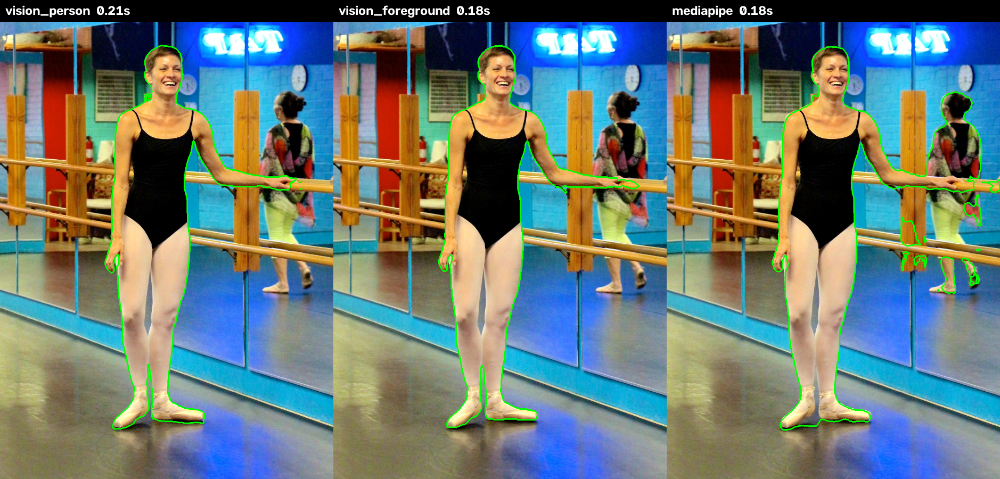

# Task 03 Proofs - Background-removal methods compared, Apple Vision person segmentation chosen

## Task Summary

Three local background-removal methods now sit behind one setting:
- Apple Vision person segmentation (`vision_person`).
- Apple Vision foreground mask (`vision_foreground`).
- MediaPipe's selfie multiclass segmenter (`mediapipe`).

A `compare_segmentation` command draws each method's outline over the same photo, side by side, writing only inside the git-ignored `recordings/` folder. Jacob compared the sheets for the 10 openly licensed fixtures and chose `vision_person`, with MediaPipe kept as the cross-platform fallback. The decision is recorded in `docs/decisions/0001-background-removal.md`.

## What This Task Proves

- All three methods run locally on Python 3.15 and return a person mask the size of the photo.
- The comparison tool writes numbered sheets (never named after the photo) only under `MEDIA_ROOT/comparisons/`.
- The method choice is evidence-based and recorded, including what is still open.

## Evidence Summary

- A comparison sheet for the dance-studio fixture shows the three outlines side by side.
- The comparison run on all 10 fixtures: every method takes about 0.1–0.5 s per photo.
- The decision record names the choice, the evidence and the open items.
- 6 task-specific tests pass; the full suite has 48.

## Artifact: Comparison sheet (openly licensed fixture)

**What it proves:** the tool puts the three methods side by side on one photo, so boundaries can be judged by eye.

**Why it matters:** the "best boundary" choice was made from sheets like this one.

**Artifact path:** `docs/specs/02-spec-portrait-mapping/02-proofs/02-task-03-comparison.png` (fixture `10-flickr-female-leotard-mirror.jpg`, "Happy Beginning Adult Ballet Dancer Living Her Dream!!" by Chic Bee, CC BY 2.0)

**Result summary:** both Apple Vision methods outline only the dancer. MediaPipe also picks up the second person in the mirror, plus stray fragments.

## Artifact: Comparison run on the 10 fixtures

**Command:** `uv run manage.py compare_segmentation tests/fixtures/images`

**Result summary:** every method ran on every fixture, and the sheets were written to `recordings/comparisons/<timestamp>/` (git-ignored).

~~~text
photo                                          vision_person   vision_foreground           mediapipe
01 01-commons-male-anatomical.jpg                      0.56s               0.19s               0.56s
02 02-commons-female-anatomical.jpg                    0.10s               0.07s               0.22s
03 03-commons-male-busy-background.jpg                 0.12s               0.09s               0.18s
04 04-commons-male-bike-occlusion.jpg                  0.19s               0.17s               0.18s
05 05-commons-female-long-hair.jpg                     0.17s               0.13s               0.21s
06 06-commons-female-dark-background.jp                0.17s               0.14s               0.17s
07 07-commons-male-swim-briefs.jpg                     0.11s               0.07s               0.17s
08 08-fortepan-male-1966-street.jpg                    0.16s               0.11s               0.17s
09 09-flickr-female-clothed-gallery.jpg                0.20s               0.16s               0.18s
10 10-flickr-female-leotard-mirror.jpg                 0.21s               0.18s               0.18s
Wrote 10 sheets to recordings/comparisons/2026-10-25_16-50-03
~~~

## Artifact: Decision record

**Artifact path:** `docs/decisions/0001-background-removal.md`

**Result summary:**
- **Chosen:** `vision_person`, with `mediapipe` as the cross-platform fallback. `SEGMENTATION_METHOD = 'vision_person'`.
- **Noted:** the open-water fixture (sheet 07) is the hardest case. `vision_person` cuts into a thigh and runs into the water, which is a job for future mask editing.
- **Open items:**
  - Not yet checked on private portraits.
  - Jacob prefers cross-platform tools in the long run.
  - Landmarks may use MediaPipe in task 5.0.

## Artifact: Segmentation and comparison-tool tests

**What it proves:**
- Each method returns a float32 mask the photo's size, in 0..1, covering a plausible share of a studio portrait.
- `segment()` uses the configured method.
- The tool writes one numbered sheet per photo, only under `MEDIA_ROOT/comparisons/`, and never uses the photo's file name. A file named "Jane Doe.jpg" leaves no trace of the name.

**Command:** `uv run pytest -v tests/test_segmentation.py tests/test_compare_command.py`

~~~text
tests/test_segmentation.py::test_method_returns_a_person_mask_the_size_of_the_photo[vision_person] PASSED
tests/test_segmentation.py::test_method_returns_a_person_mask_the_size_of_the_photo[vision_foreground] PASSED
tests/test_segmentation.py::test_method_returns_a_person_mask_the_size_of_the_photo[mediapipe] PASSED
tests/test_segmentation.py::test_segment_uses_the_configured_method PASSED
tests/test_compare_command.py::test_writes_one_numbered_sheet_per_photo_inside_media_root PASSED
tests/test_compare_command.py::test_sheet_names_never_include_the_photo_name PASSED
============================== 6 passed in 1.47s ===============================
~~~

Full suite: `48 passed`. `ruff check`, `ruff format --check` and `makemigrations --check` are clean.

## Deviation from the plan

- **Sub-task 3.7 / Success Metric 1:** the comparison was not run on at least 5 private portraits. Jacob chose from the 10 openly licensed fixtures. This is recorded as open in the decision record.
- **Sub-task 3.9:** the screenshot is the comparison sheet itself, an image file the tool writes, so no screen capture was needed.

## Reviewer Conclusion

Background removal is in place behind one setting, with an evidence-based (if fixture-only) choice of Apple Vision person segmentation and a cross-platform fallback ready.
