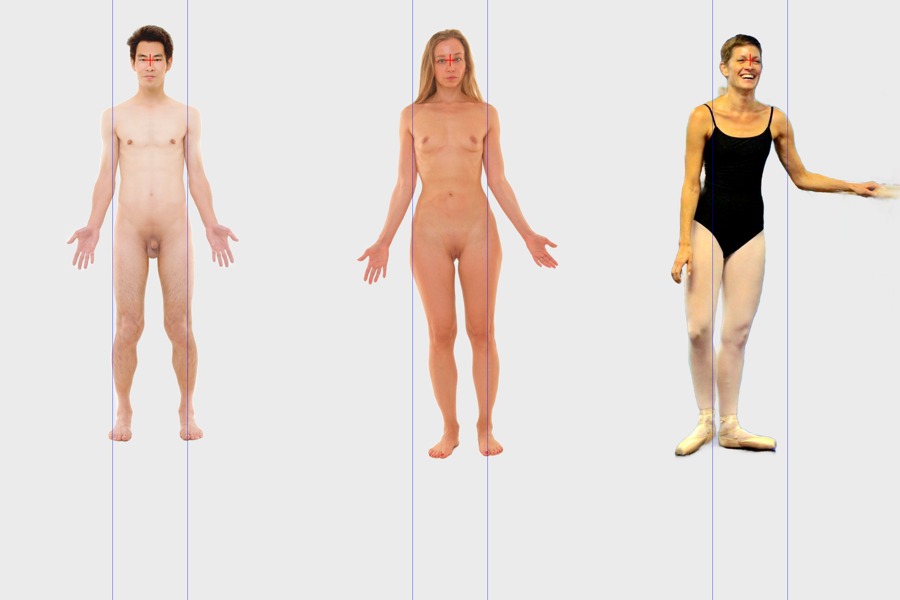

# Task 05 Proofs - Key points and alignment to the standard grid

## Task Summary

Each import now finds named body points with MediaPipe, which is cross-platform. The pose landmarker gives 33 body points, and the face mesh's nasion point gives `nose_bridge`. All of them are stored as PostGIS points. The portrait is then aligned to the standard grid:
- The nose bridge goes to (500, 200).
- The shoulder line becomes horizontal.
- Shoulder width is set to 250 grid units.

The alignment numbers, the outline and every point are stored in grid coordinates too, alongside an aligned image. When the nose bridge or a shoulder can't be found, the portrait is still kept, marked "not aligned" with the reason.

## What This Task Proves

- The alignment math puts the nose bridge within 0.5 units of the grid point, makes the shoulders 250 units apart (within 0.5%) and level (within 0.5°), and round-trips grid → photo → grid within 0.5 units. This holds for tilted, scaled and shifted bodies, either shoulder naming, and upper-body-only points.
- MediaPipe finds the nose bridge and both shoulders on all 10 openly licensed fixtures.
- Aligned portraits store key points in both coordinate systems, plus `outline_grid`, the alignment numbers and `aligned.png`. Portraits that can't be aligned keep their outline and points, with a clear reason ("face not found", "left shoulder not found").
- Real imports land every nose bridge at exactly (500, 200) in PostGIS.

## Evidence Summary

- A `psql` query of three real imports shows each nose bridge at (500.00, 200.00) on the grid.
- An image of the three aligned cutouts shows the nose bridges on the cross and the shoulders on the 250-unit lines.
- 25 task-specific tests pass; the full suite has 81. Lint, format and migrations are clean.

## Artifact: Nose bridges stored on the grid point

**What it proves:** alignment is applied and stored in PostGIS for real photos.

**Command:**

~~~bash
psql -h localhost -d heatmap -c "select s.display_name, round(ST_X(k.point_grid)::numeric,2) as grid_x, round(ST_Y(k.point_grid)::numeric,2) as grid_y from body_map_keypoint k join body_map_portrait p on p.id = k.portrait_id join body_map_subject s on s.id = p.subject_id where k.name = 'nose_bridge' and k.point_grid is not null order by s.display_name;"
~~~

**Result summary:** three real imports (Demo Images 01 and 02, and fixture 10) each stored 34 key points (33 pose points plus `nose_bridge`), with the nose bridge at exactly the grid point. Imports took 0.8–1.4 s.

~~~text
Demo 01 aligned - keypoints 34 1.43s
Demo 10 aligned - keypoints 34 0.82s
Demo 02 aligned keypoints 34

 display_name | grid_x | grid_y
--------------+--------+--------
 Demo 01      | 500.00 | 200.00
 Demo 02      | 500.00 | 200.00
 Demo 10      | 500.00 | 200.00
~~~

## Artifact: Aligned cutouts side by side

**What it proves:** different photos (different sizes, framing and camera distance) land in the same place at the same scale.

**Artifact path:** `docs/specs/02-spec-portrait-mapping/02-proofs/02-task-05-aligned.png`. The red cross marks the nose-bridge grid point, and the blue lines are 250 units apart for the shoulders.

**Credits:**
- 01 and 02: Mikael Häggström / City Studios Stockholm, CC0, via Wikimedia Commons.
- 10: "Happy Beginning Adult Ballet Dancer Living Her Dream!!" by Chic Bee, CC BY 2.0. Background removed, aligned and downscaled.

**Result summary:** all three nose bridges sit on the cross, and the shoulders meet the blue lines. The dancer is leaning on a barre, so making her shoulder line level tilts her body slightly. That's the expected trade-off of taking rotation from the shoulders.

## Artifact: Alignment and landmark tests

**Command:** `uv run pytest -v tests/test_alignment.py tests/test_landmarks_pipeline.py`

**Result summary:** 25 passed. The pipeline tests use fake segmentation and landmarks for predictable results; the fixture tests run real MediaPipe.

~~~text
tests/test_landmarks_pipeline.py::test_aligned_portrait_stores_points_outline_and_image PASSED
tests/test_landmarks_pipeline.py::test_no_face_keeps_portrait_as_not_aligned PASSED
tests/test_landmarks_pipeline.py::test_one_missing_shoulder_is_named PASSED
tests/test_alignment.py::test_nose_bridge_lands_on_the_grid_point[nose0-sa0-sb0] PASSED
tests/test_alignment.py::test_nose_bridge_lands_on_the_grid_point[nose1-sa1-sb1] PASSED
tests/test_alignment.py::test_nose_bridge_lands_on_the_grid_point[nose2-sa2-sb2] PASSED
tests/test_alignment.py::test_shoulder_width_and_level[nose0-sa0-sb0] PASSED
tests/test_alignment.py::test_shoulder_width_and_level[nose1-sa1-sb1] PASSED
tests/test_alignment.py::test_shoulder_width_and_level[nose2-sa2-sb2] PASSED
tests/test_alignment.py::test_round_trip_grid_to_px_and_back[nose0-sa0-sb0] PASSED
tests/test_alignment.py::test_round_trip_grid_to_px_and_back[nose1-sa1-sb1] PASSED
tests/test_alignment.py::test_round_trip_grid_to_px_and_back[nose2-sa2-sb2] PASSED
tests/test_alignment.py::test_left_and_right_naming_does_not_matter PASSED
tests/test_alignment.py::test_upper_body_only_points_align PASSED
tests/test_alignment.py::test_polygon_is_moved_onto_the_grid PASSED
tests/test_landmarks_pipeline.py::test_mediapipe_finds_nose_bridge_and_shoulders_on_fixtures[01] PASSED
tests/test_landmarks_pipeline.py::test_mediapipe_finds_nose_bridge_and_shoulders_on_fixtures[02] PASSED
tests/test_landmarks_pipeline.py::test_mediapipe_finds_nose_bridge_and_shoulders_on_fixtures[03] PASSED
tests/test_landmarks_pipeline.py::test_mediapipe_finds_nose_bridge_and_shoulders_on_fixtures[04] PASSED
tests/test_landmarks_pipeline.py::test_mediapipe_finds_nose_bridge_and_shoulders_on_fixtures[05] PASSED
tests/test_landmarks_pipeline.py::test_mediapipe_finds_nose_bridge_and_shoulders_on_fixtures[06] PASSED
tests/test_landmarks_pipeline.py::test_mediapipe_finds_nose_bridge_and_shoulders_on_fixtures[07] PASSED
tests/test_landmarks_pipeline.py::test_mediapipe_finds_nose_bridge_and_shoulders_on_fixtures[08] PASSED
tests/test_landmarks_pipeline.py::test_mediapipe_finds_nose_bridge_and_shoulders_on_fixtures[09] PASSED
tests/test_landmarks_pipeline.py::test_mediapipe_finds_nose_bridge_and_shoulders_on_fixtures[10] PASSED
============================== 25 passed in 3.94s ==============================
~~~

Full suite: `81 passed`. `ruff check`, `ruff format --check` and `makemigrations --check` are clean.

## Notes and deviations

- **Landmarks use MediaPipe, not the background-removal winner (Apple Vision).** Jacob chose this for cross-platform reasons; it is also recorded in the decision record and in sub-task 5.4.
- **The face mesh runs on a crop around the head.** On full-body photos the face is too small for the face landmarker; it found a face in only 4 of 10 fixtures. With a crop built from the pose's head points, it found the nose bridge on all 10, within a few pixels of the eye midpoint.
- **Neither detector finds nipples, the navel or sex.** These are needed for the heat map and are recorded as spec 02 Open Question 5 for the body-areas spec. `Keypoint` stores points by name, so adding them needs no schema change.

## Reviewer Conclusion

Every importable portrait now lands on the standard grid at a common position and scale, stored in PostGIS in both coordinate systems. Portraits that can't be aligned are kept and flagged rather than lost.
