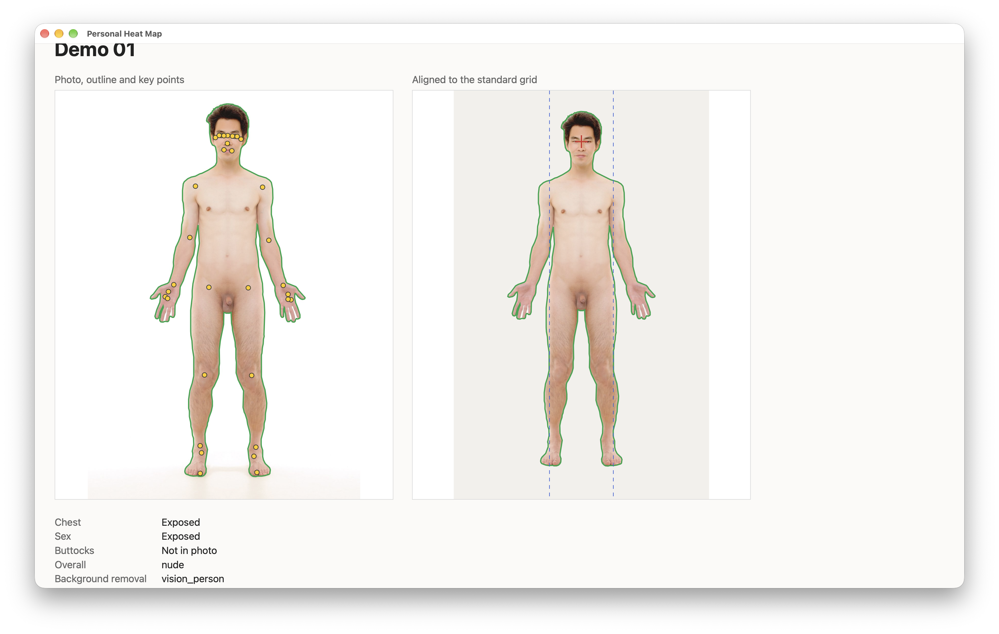
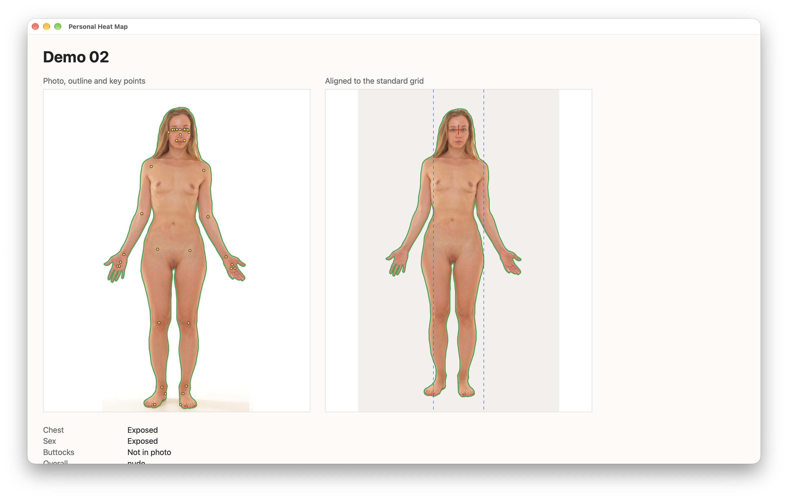
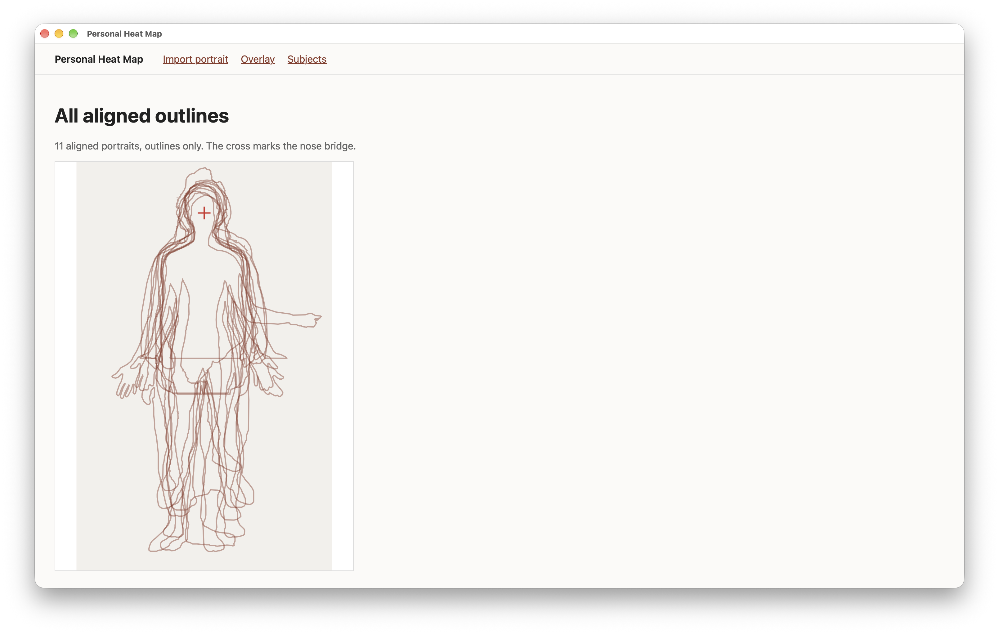

# Task 06 Proofs - Portrait view, all-subjects overlay, and alignment reworked after review

## Task Summary

The app now shows what the mapping produced.

- **Portrait view:**
  - The photo with its body outline and key points.
  - The aligned cutout on the standard grid, with the nose-bridge cross and shoulder-width lines.
  - The coverage, overall level, background-removal method and alignment status. A not-aligned portrait shows its reason instead.
- **Overlay:** every aligned outline stacked on one grid, outlines only, with no photos.

Reviewing the first screenshots led to two changes to alignment:
- **No rotation:** photos stay upright as taken. Leveling the shoulders tilted bodies whose shoulders sit naturally uneven, which pushed Demo 02 sideways.
- **A 1000 × 1600 grid:** the 2000-tall grid left bodies bunched at the top.

A new `realign_portraits` command re-applies alignment to existing portraits, so grid settings can be tuned without re-importing.

## What This Task Proves

- Each portrait can be inspected in the app: outline, points (named on hover), aligned result, coverage and status.
- The overlay shows cross-subject alignment without revealing any image.
- Spatial questions work across subjects: every aligned body contains the grid point 100 units below the nose bridge.
- A self-crossing outline (the bike fixture) is repaired correctly. This bug was found while importing the fixtures, and is now fixed and tested.

## Evidence Summary

- Screenshots of the portrait view (Demo Images 01 and 02) and of the overlay (11 outlines).
- A spatial query returns all 10 demo subjects; 11 of 11 aligned portraits contain the point.
- 10 task-specific tests pass; the full suite has 92. Lint, format and migrations are clean.

## Artifact: Portrait view, Demo Image 01

**Artifact path:** `docs/specs/02-spec-portrait-mapping/02-proofs/02-task-06-portrait-view.png` (Mikael Häggström / City Studios Stockholm, CC0)

**Result summary:**
- **Left:** the photo with a green outline following the body, and yellow key points on the face, shoulders, elbows, wrists, hands, hips, knees, ankles and feet.
- **Right:** the aligned cutout fills the 1000 × 1600 grid, upright, with the nose bridge on the red cross and the dashed lines at shoulder width.
- **Below:** coverage (Chest exposed, Sex exposed, Buttocks not in photo), the level ("nude") and the method (`vision_person`).

## Artifact: Portrait view, Demo Image 02 (after the no-rotation change)

**Artifact path:** `docs/specs/02-spec-portrait-mapping/02-proofs/02-task-06-portrait-view-02.png` (CC0, as above)

**Result summary:** this is the portrait that looked "pushed sideways" when the shoulder line was leveled. With no rotation she stands upright and centered on the nose bridge, as in the original photo.

## Artifact: All-subjects overlay

**Artifact path:** `docs/specs/02-spec-portrait-mapping/02-proofs/02-task-06-overlay.png`

**Result summary:**
- 11 aligned outlines (the 10 fixtures, plus one private subject shown only as an unlabeled outline) are stacked on the grid, with heads and shoulders lining up at the cross.
- **Horizontal straight edges near hip level:** these are half-body photos, whose outlines run along the bottom edge of the photo.
- **The long sideways shape:** the dancer's arm on the barre.

## Artifact: Spatial query across subjects

**What it proves:** the stored grid geometry answers cross-subject spatial questions. The point (500, 300) is 100 units below the nose bridge, so it should be inside every aligned body.

**Commands:**

~~~bash
psql -h localhost -d heatmap -c "select s.display_name from body_map_portrait p join body_map_subject s on s.id = p.subject_id where s.display_name like 'Demo %' and ST_Contains(p.outline_grid, ST_SetSRID(ST_Point(500, 300), 3857)) order by 1;"
psql -h localhost -d heatmap -Atc "select count(*) || ' of ' || (select count(*) from body_map_portrait where alignment_status='aligned') || ' aligned portraits contain the point' from body_map_portrait where ST_Contains(outline_grid, ST_SetSRID(ST_Point(500, 300), 3857));"
~~~

**Result summary:** all 10 demo subjects are returned, and 11 of 11 aligned portraits contain the point. (The first query lists demo subjects only, so no private subject's name appears here.)

~~~text
 display_name
--------------
 Demo 01
 Demo 02
 Demo 03
 Demo 04
 Demo 05
 Demo 06
 Demo 07
 Demo 08
 Demo 09
 Demo 10
(10 rows)

11 of 11 aligned portraits contain the point
~~~

## Artifact: View and outline tests

**What it proves:**
- The portrait view shows the coverage labels, level, aligned panel and named points.
- A not-aligned portrait shows its reason and no grid panel.
- The overlay draws one outline per aligned portrait and contains no `` or `<image>`.
- Import redirects to the new portrait, and the home screen links to it and flags not-aligned ones.
- A self-touching outline is repaired to its largest part.

**Command:** `uv run pytest -v tests/test_views.py tests/test_outline.py`

~~~text
tests/test_views.py::test_portrait_view_shows_coverage_level_and_alignment PASSED
tests/test_views.py::test_not_aligned_portrait_shows_reason_and_no_grid_panel PASSED
tests/test_views.py::test_overlay_draws_one_outline_per_aligned_portrait_and_no_photos PASSED
tests/test_views.py::test_import_redirects_to_the_new_portrait PASSED
tests/test_views.py::test_home_links_to_portrait_and_flags_not_aligned PASSED
tests/test_outline.py::test_outline_is_a_valid_closed_polygon_of_the_body PASSED
tests/test_outline.py::test_soft_mask_is_thresholded_at_one_half PASSED
tests/test_outline.py::test_empty_mask_is_rejected PASSED
tests/test_outline.py::test_tiny_body_is_rejected PASSED
tests/test_outline.py::test_self_touching_outline_is_repaired_to_its_largest_part PASSED
============================== 10 passed in 0.65s ==============================
~~~

Full suite: `92 passed` (including new tests for no rotation and for `realign_portraits`). `ruff check`, `ruff format --check` and `makemigrations --check` are clean.

## Changes from the plan (Jacob's review, 2026-10-25)

- **Rotation removed.** The spec said to level the shoulder line. Now the photo is never rotated; the spec, task list, alignment tests and `body_map/alignment.py` are updated.
- **Grid resized** from 1000 × 2000 to 1000 × 1600, from the measured extents of the 10 aligned fixtures (y ≈ 20–1530).
- **Added `uv run manage.py realign_portraits`** to re-apply alignment after changing grid settings. The spec anticipated this ("recompute grid geometry from the stored original geometry").

## Reviewer Conclusion

The mapping MVP is visible end to end in the app. Each portrait shows its outline, points and aligned form, and all aligned bodies share one grid that answers spatial questions. The alignment was adjusted after review to keep bodies upright and filling the frame.
